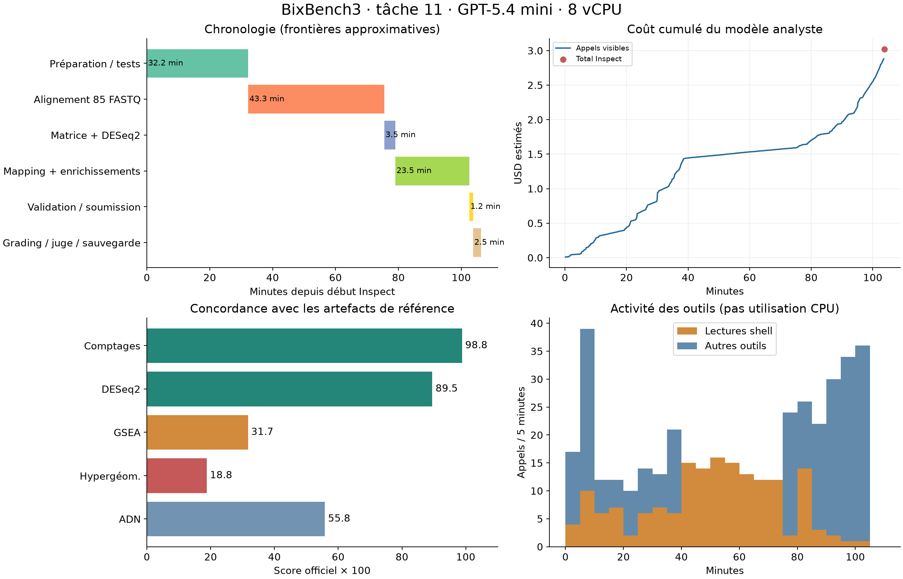
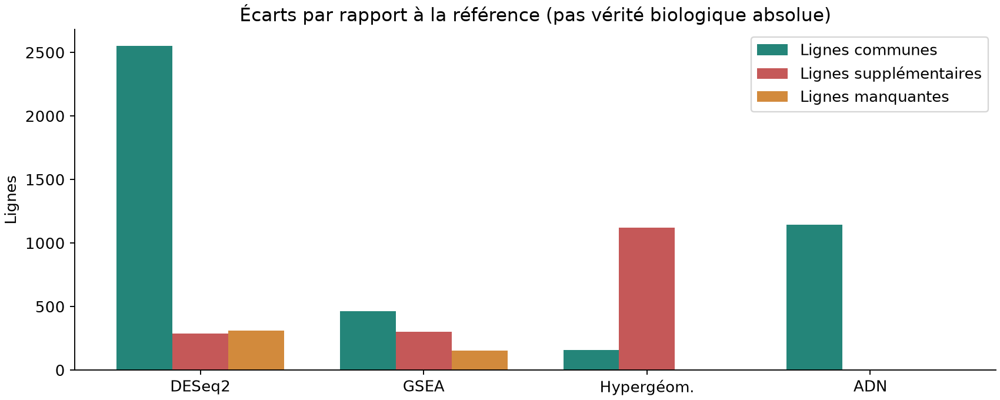

# Baseline — task 11

Run date: November 14, 2026. Task: `10.1016_j.crtox.2021.01.003_v1`.

## Setup

- Analyst: `openai/gpt-5.4-mini`, requested effort `max`, resolved `xhigh`.
- Original Inspect harness, task prompt, grader and network gateway. Source archive commit: `d0e0bbb41222335b1b8878f533a58466a3a782dc`.
- GCP `n2-standard-8`: 8 vCPU, 32 GB RAM; 200 GB boot disk; task11 runtime without Cell Ranger/ARC. This differs from the original 32-vCPU hardware configuration.
- Limits: 24 hours and 5,000 messages; no additional analyst cost cap.
- Dataset release: `EdisonScientific/BixBench3`, `v1.0.0`. The trace contains the task prompt, tool outputs and analysis code, not the full raw dataset.

## Results

| Artifact | Official score |
|---|---:|
| TempO-Seq counts | 0.988138 |
| DESeq2 significant DEGs | 0.895164 |
| Preranked GSEA | 0.316921 |
| Hypergeometric pathways | 0.187736 |
| DNA damage enrichment | 0.558045 |
| **Overall** | **0.589201** |

Process-judge score: 0.83 (a different measure from artifact concordance).
All five output files were produced. Technical completion does not imply method compliance.

Agent time: **1 h 43 min 45 s**, 22:11:53–23:55:38 UTC. Grading, judging and upload finished around 23:58:08 UTC. 406 model calls and 407 tool calls, including 168 shell reads and three shell restarts.

Estimated analyst cost: **$3.023** from aggregate Inspect usage (715,803 uncached input, 23,203,712 cached input, 165,780 output tokens; 121,009 reasoning tokens are included in output). Rates used per million: $0.75 / $0.075 / $4.50. Visible model events account for $2.881; $0.142 is not attributed to individual visible calls. A context compaction occurred, but attribution of the difference is unproven.
Estimated run-VM compute: **about $0.82**. Combined analyst + VM compute: **about $3.84**, excluding judges, storage, network, runtime construction and data preparation. These are estimates, not verified invoices or credit balances. The VM was deleted after collection; persistent storage is separate.

Main issues: runtime package installation and shell stalls; Bowtie substituted for QuasR, babelgene for BioMart/Ensembl 100, gseapy for PIANO; R/DESeq2 version differences; excessive polling. Hypergeometric output has 157 expected rows recovered, 1 missing and 1,120 extra. See `grade.json` for exact metrics and `judge.json` for the judge's evidence and limitations.

## Files and viewing

- `inspect.eval`: original Inspect log, readable by Inspect's viewer.
- `inspect.json.gz`: JSON export of the full log, including messages, events and attachments.
- `tool-trace.html`: searchable, self-contained tool timeline with resolved code/command attachments. Download and open locally.
- `model-calls.csv`: per-visible-call timing and usage; does not fully reconcile to aggregate usage (see above).
- `metrics.json`, `grade.json`, `judge.json`, `run_manifest.json`: aggregate usage, scientific grading, process grading and provenance. Operator account email omitted from the manifest.
- `overview.png`, `artifact-errors.png`: timeline, costs and artifact diagnostics.
- `sha256.json`: hashes of exported data/figure files.

With Inspect installed, run `inspect view --log-dir iterations/baseline-task11` from the repository root. For programmatic inspection:

```python
from inspect_ai.log import read_eval_log
log = read_eval_log('iterations/baseline-task11/inspect.eval')
print(log.stats.model_usage)
```

The saved traces expose API-visible messages and tool activity, not private model reasoning. Credentials were checked before publication; no API key or HF token is intentionally included. The original benchmark and dataset retain their own terms; this run archive does not relicense them.



